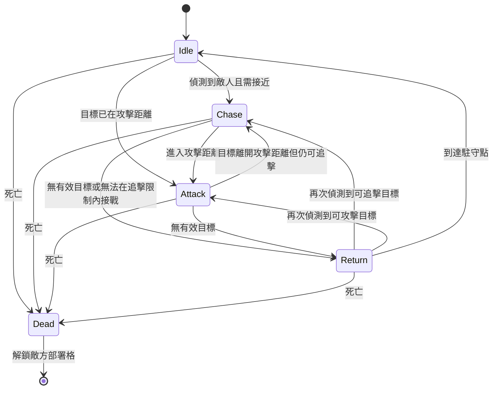

# 《王國狂想》戰場地圖與部署設計 V0.3

更新日期：2026-11-27

本文件記錄三路戰場、格子部署、中央危險區、王子巡邏及護衛駐守的設計。配合 [卡牌設計](card-design.md) 與 [初始戰鬥數值 V0.1](card-balance-v0.1.md) 閱讀。本機對練以此文件為原型基準，操作與實測項目見[對練說明](battle-practice.md)。

## 1. 核心方向與狀態

已確認的方向：

- 直式、雙方對稱的三路戰場；中央通道的危險區較短，定期造成傷害。
- 下兵以格子計算，召喚後角色仍使用連續世界座標移動及戰鬥，不是回合制格子移動。
- 左右護衛固定駐守，只防守部分區域；有敵人才出擊，沒有敵人就走回駐守點並播放 Idle。
- 擊殺敵方護衛會解鎖對應側路的前方部署格，可深入敵方原始部署區；雙方部署權可以重疊。
- 王子不攻擊，沿己方後場的封閉環形路線巡邏，玩家可以主動讓王子奔跑 N 秒。

以下尺寸、初始部署深度、解鎖格數、巡邏座標、危險區傷害及技能時間均是原型測試值，不是已實戰定案的數值。新增的具體座標、轉角半徑、同格競爭處理及追擊邊界等為文件整理時補充的實作建議。

## 2. 地圖尺寸與座標

| 屬性 | V0.3 初始值 |
| --- | ---: |
| 地圖寬度 | 18 Units |
| 地圖長度 | 32 Units |
| 長寬比（寬：長） | 9:16 |
| 單格大小 | 1 × 1 Units |
| 橫向列數（columns） | 18 |
| 縱向行數（rows） | 32 |
| 總格數 | 576 |
| 每路寬度 | 6 格 |
| 中央危險區 | 6 × 4 格 |
| 初始部署區（每方） | 90 格 |
| 單側護衛死亡解鎖 | 72 格 |
| 最大部署區（每方） | 234 格 |

Unit 表示 Unity 世界座標單位，並非像素。以下統一以俯視 2D 的 X/Y 平面描述；若實作用 X/Z 地面，將 Y 對應 Z 即可。

- 原點位於地圖中心 (0, 0)，X 正向往畫面右側，Y 正向往敵方（上方）。
- 地圖範圍 X = [-9, 9]，Y = [-16, 16]。陣營 A 在下方，陣營 B 在上方。
- 格子採零起始索引：列 c = 0–17、行 r = 0–31，由左至右、由上至下。
- 格中心座標：x = c - 8.5，y = 15.5 - r。
- 左路 c = 0–5（X -9 至 -3）；中路 c = 6–11（X -3 至 3）；右路 c = 12–17（X 3 至 9）。
- 本文件的左、右固定使用全局畫面方向。B 陣營的玩家視角若旋轉 180°，UI 左右與全局欄位須轉換，不得將擊殺事件映射到錯側部署區。

### 2.1 地圖示意（非正式美術）

以下為 A 方在下、B 方在上的簡化圖；每欄代表六格寬的一條路。

```text
                B 方後場
        ┌───────────────────────┐
        │   ┌─ 王子環形巡邏 ─┐  │
        │ B左衛              B右衛 │
        ├───────┬───────┬───────┤
 r6–10  │ B部署 │ B部署 │ B部署 │
        ├───────┼───────┼───────┤
        │       │       │       │
 r14–17 │ 左路  │危險區 │ 右路  │
        │       │       │       │
        ├───────┼───────┼───────┤
 r21–25 │ A部署 │ A部署 │ A部署 │
        ├───────┴───────┴───────┤
        │ A左衛              A右衛 │
        │   └─ 王子環形巡邏 ─┘  │
        └───────────────────────┘
                A 方後場
```

三條路為進攻及部署規劃分區，先不加實體隔牆。單位平時沿所屬路線前進，偵測敵人後依索敵規則接戰；跨路追擊限制待原型驗證。中央路只有短區段的危險地形，不是整條路都造成傷害。

## 3. 格子部署規則

### 3.1 初始與擴張範圍

行、列端點皆包含。以下座標表為權限計算的唯一基準，避免示意圖與實際格數不一致。

| 部署權限 | c 範圍 | r 範圍 | 格數 | 解鎖條件 |
| --- | --- | --- | ---: | --- |
| A 初始 | 0–17 | 21–25 | 90 | 開局 |
| B 初始 | 0–17 | 6–10 | 90 | 開局 |
| A 左路擴張 | 0–5 | 9–20 | 72 | B 左護衛死亡 |
| A 右路擴張 | 12–17 | 9–20 | 72 | B 右護衛死亡 |
| B 左路擴張 | 0–5 | 11–22 | 72 | A 左護衛死亡 |
| B 右路擴張 | 12–17 | 11–22 | 72 | A 右護衛死亡 |

每方可部署格數 = 90 + 72 × 已擊殺敵方護衛數；開局 90、單側解鎖 162、雙側解鎖 234。這是部署權限格數，不扣除當下被占用而暫時不可召喚的格子。

- 每側擴張都進入對方初始部署區兩行（深度 2 Units，共 12 格）。
- 若雙方同側護衛都死亡，同側 r9–22 皆可由雙方部署，共 84 格。
- 左右側獨立計算。雙方四名護衛皆死亡時，共有 168 格雙方皆可部署。
- 擴張不移除敵方原有部署權，不是領土占領；雙方以各自獨立的權限集合判斷。
- 擊殺護衛只解鎖對應側路，中路及雙方王子巡邏區不新增部署格。
- 中央危險區本身禁止部署；敵方後場的王子巡邏區仍禁止直接下兵。
- 原型暫以護衛死亡後本局持續解鎖、護衛不重生為建議；如果後續引入重生，須重新決定部署權是否收回。

### 3.2 操作與判定

1. 玩家選取或拖曳單位卡時顯示己方有權部署的格子。
2. 指標位置吸附至合法格中心，顯示角色預覽；不合法時以明確紅色或禁止提示標記。
3. 放開或確認時再次檢查卡牌、資源、部署權、格子及角色碰撞是否合法；成功才召喚並扣除資源。
4. 已有角色占據的格子暫不可召喚。角色離開後可恢復；實際角色碰撞尺寸也需檢查，以免相鄰格子的大型角色重疊。
5. 雙方同時要求在相同格下兵時，原型建議在權威戰鬥狀態中依確定性順序驗證，後到且已占用的請求拒絕、不扣資源。順序與網路架構後續定案。
6. 召喚後角色自由移動，格線不限制走路、追擊或攻擊範圍。
7. 法術不受單位部署權限制，可指定有效戰場位置／方向；是否將法術落點吸附格中心仍待 UI 測試。

平時不必顯示滿版格線，僅在選卡或拖曳時顯示己方可用格；重疊區需要清楚提示雙方均有部署權。

## 4. 三路戰術與中央危險區

| 路線 | 戰術 | 代價 |
| --- | --- | --- |
| 左路 | 穩定進攻、擊殺左護衛後取得部署優勢 | 較容易遭遇同側護衛 |
| 中路 | 掌握地形時間，嘗試繞過側路護衛直接推進 | 週期性地形傷害；沒有護衛解鎖的部署擴張 |
| 右路 | 穩定進攻、擊殺右護衛後取得部署優勢 | 較容易遭遇同側護衛 |

中路不是必然無護衛威脅，側路護衛仍可能因敵人進入各自偵測範圍而參戰；只是雙方護衛不能封鎖所有路線。

### 4.1 中央危險區（初始值）

| 參數 | 值 |
| --- | --- |
| 格子 | c6–11、r14–17，共 24 格 |
| 世界座標 | X [-3, 3]、Y [-2, 2] |
| 危險區長度 | 4 Units（由最初的 10 Units 縮短） |
| 週期 | 8 秒 |
| 預警時間 | 1.5 秒 |
| 單次傷害 | 區域內每名目標最大血量 8% |
| 影響陣營 | 敵我雙方 |
| 傷害類型 | 一般傷害，先消耗護盾 |
| 傷害次數 | 每輪爆發一次，非每秒持續扣血 |
| 額外控制 | 無 |
| 部署權 | 禁止 |

原型以戰鬥時間為準，第一次預警 t=6.5s、第一次爆發 t=8s，後續固定週期循環。爆發時依目標當下位置判定是否在區內，區域邊界及碰撞半徑的精確判定由實作統一。兩隊使用同一時間表，不使用隨機爆發，便於玩家預判。

以移速 2.5 的單位計算，無交戰阻擋、直線穿越 4 Units 約 1.6 秒；輕騎兵 4.2 約 0.95 秒。慢速或在區內交戰的單位更容易被波及。百分比傷害避免小兵因固定高傷害而受到不成比例懲罰。

目前王子巡邏路線不會進入中央危險區；若未來改變路線，王子的地形傷害規則需另行平衡，不直接套用 8%。

## 5. 王子環形巡邏

### 5.1 行為

- 王子是被保護的戰場核心，不能普通攻擊、不索敵、不追擊。
- 沿己方後場的封閉路線持續繞場，不是左右折返，也不是繞整張地圖。
- 路線暫採圓角長方形、固定方向循環，遇到敵人仍沿原路線行進，不加入自動閃避或選擇安全路徑 AI。
- 玩家主動觸發「疾行」後，維持同一條巡邏路線及方向，只在 N 秒內提升速度；時間結束恢復巡邏速度。
- 奔跑不提供無敵、護盾、減傷或回血，仍可被攻擊及法術命中；不影響護衛的位置與移速。
- 巡邏速度必須低於可攻擊的地面兵種，使近戰具備追擊機會；奔跑速度暫定高於現有最快兵種。
- 王子血量耗盡的勝負處理及同時死亡規則待確認。

### 5.2 路線與測試值

| 屬性 | 初始值 |
| --- | --- |
| 巡邏區中心 A / B | (0, -12.5) / (0, 12.5) |
| 外框寬 × 高 | 12 × 4 Units |
| 外框 X | [-6, 6] |
| 外框 Y（A） | [-14.5, -10.5] |
| 外框 Y（B） | [10.5, 14.5] |
| 建議圓角半徑 | 1.5 Units |
| 建議起始位置 A / B | (0, -14.5) / (0, 14.5) |
| 正常速度 | 1.2 Units/s |
| 奔跑速度 | 4.5 Units/s |
| 奔跑持續時間 N | 3 秒 |
| 技能冷卻 | 15 秒 |
| 最大血量 | 6,000 |
| 攻擊力 | 不適用（無攻擊） |

路線座標、圓角、起點及循環方向是實作建議。兩隊應採鏡像路徑，從各自玩家視角具等價性。依上述圓角長方形估算單圈約 29.4 Units、普通移速約 24.5 秒一圈；奔跑 3 秒可走 13.5 Units。實際長度以 Scene 的路徑曲線為準。

冷卻從觸發或技能結束開始計算尚未確認；第一版建議從觸發起算，避免文件中的 15 秒有兩種解讀。王子與其他角色的碰撞、暈眩及減速是否中斷路線需進一步定案；不可因路線被阻塞導致永久卡住，也不先賦予無視所有碰撞的能力。

## 6. 固定護衛

護衛不跟隨王子，也不作為可下兵的卡牌。每側可獨立選擇長槍兵或弩手。

### 6.1 駐守座標

| 駐守點 | A 方 | B 方 |
| --- | --- | --- |
| 全局左 | (-7.5, -11.5) | (-7.5, 11.5) |
| 全局右 | (7.5, -11.5) | (7.5, 11.5) |

| 參數 | 皇家長槍護衛 | 皇家弩手護衛 |
| --- | ---: | ---: |
| 偵測半徑（以原始駐守點為中心） | 6.0 | 6.0 |
| 最大追擊距離（護衛自身與駐守點距離） | 4.5 | 4.5 |
| 攻擊距離 | 1.8 | 6.0 |
| 移速 | 3.0 | 2.8 |

左右駐守點相距 15 Units，兩個半徑 6 的偵測圓在同一水平線留下約 3 Units 的空隙，中央路可有避開初始偵測的機會。不代表移動中的弩手攻擊範圍一定不會碰到中央，需實際測試。

弩手和新手弓手射程同為 6.0，護衛在原位的偵測半徑也不小於此射程，避免單純因射程／偵測距離差而無法反擊。最大追擊距離與偵測邊界仍有可能產生邊界消耗，需測試而非保證完全無死角。

### 6.2 AI 狀態流程



- 偵測區固定在原始駐守點，護衛不會因移動而無限擴大防守範圍。
- 選擇偵測區內的有效敵人；原型建議優先最近可接戰的目標。
- 若目標已在攻擊距離則原地攻擊，否則移動接敵，但護衛自身不能超過最大追擊距離。
- 目標死亡、離開有效區域或無法在追擊限制內接戰時，重新搜尋；無有效目標就返回原位播放 Idle。
- 返回途中若再次偵測到敵人可重新接戰，不強制先回到駐守點（實作建議）。
- 不加入跟隨王子或全圖追擊行為。
- 死亡事件只解鎖對方對應側路的部署格一次。

## 7. 單位索敵與進攻

| 類型 | 基礎行為 |
| --- | --- |
| 一般攻擊型（NearestEnemy） | 從部署位置沿對應路線前進，優先攻擊偵測範圍內最近的有效敵方單位，包含護衛和王子 |
| 王子專攻型（PrinceOnly） | 沿路線推進、追擊敵方王子，忽略其他攻擊目標；被攻擊不切換目標 |
| 支援型（Support） | 跟隨附近友軍並提供增益或治療，不主動攻擊 |
| 固定護衛（Guard） | 使用第 6 節的駐守偵測與回位狀態 |
| 王子（PatrolOnly） | 使用第 5 節環形巡邏與主動奔跑 |
| 法術型（Spell） | 玩家選擇戰場位置／方向，依卡牌規則命中 |

目前初步分類：輕騎兵為唯一王子專攻型；軍旗手、醫官為支援型；其餘 14 種召喚兵種為一般攻擊型（17 種可召喚兵種合計）。分類及完整數值詳見 [初始戰鬥數值](card-balance-v0.1.md)。

王子專攻不代表無碰撞、無視前排阻擋或免疫控制。單位部署之後自由移動，路線由部署格所在欄位決定初始推進方向；進入對方後場如何從路線轉向王子、跨路尋敵、沒有友軍時支援角色如何移動，以及一般兵種偵測半徑仍待確定。

攻擊動畫的命中幀應與傷害判定對齊；原型建議近戰在命中時確認目標仍在有效命中範圍。需要測試最慢的近戰兵種在王子正常巡邏時能追上並命中，不能只比較兩者的移速就假設一定能命中。

## 8. 美術與 Unity 實作建議

- 王國遺跡主題，保持風格化中世紀奇幻厚塗美術。左右路採石板與草地，中路的短危險區使用魔法裂痕；護衛駐守點可使用皇家旗幟與小石台。
- 王子環形巡邏區保留清楚地面空間，地圖邊緣裝飾避免遮擋戰鬥視野。
- 地圖底圖、格線提示、危險區預警、傷害特效、部署權顯示分層，不把動態效果畫死在地圖圖檔上。
- 以資料設定格子尺寸、各隊部署遮罩、護衛 ID 與解鎖格集合、危險區週期、巡邏路徑及追擊半徑。未來新增地圖不必重寫戰鬥核心。
- 權限與占用判定分開，讓雙方重疊部署及格子占用都有獨立資料來源。
- 戰鬥時間、傷害、部署與護衛死亡事件以同一戰鬥狀態為準。動畫表現不直接決定部署權。

## 9. 驗證清單（尚未執行 Unity 實戰）

| 測試 | 預期 |
| --- | --- |
| 全地圖格中心與世界座標轉換 | 18×32 共 576 格；邊界外不可部署 |
| 初始部署 | 雙方各 90 格，不重疊 |
| B 左護衛死亡 | A 左路新增 72 格，總數 162；重疊 12 格；B 仍有 90 格 |
| A、B 左護衛皆死亡 | 雙方各 162 格；同側重疊 84 格 |
| 四名護衛皆死亡 | 雙方各 234 格；共重疊 168 格 |
| 在重疊格召喚 | 雙方皆具有權限，但占用及碰撞仍需判定 |
| 危險區部署 | 無論護衛生死都禁止 |
| 危險區爆發 | 雙方同時依各自最大血量扣傷害，護盾先吸收，區外不受傷 |
| 王子巡邏 | 環形循環，不攻擊、不因敵人自動改道 |
| 王子奔跑 | 速度提升 3 秒，路線不改變，時間到恢復正常速度 |
| 追擊王子 | 最慢可攻擊兵種在正常巡邏時有足夠命中機會 |
| 護衛偵測與回位 | 敵人接近才出擊，未超過追擊限制，無有效敵人回位 Idle |
| 左右護衛皆存活 | 不完全封鎖全場；中路仍存在可行的進攻機會 |
| 護衛死亡與視角 | 正確解鎖全局對應側，不因玩家視角鏡像而解錯 |
| 王子專攻輕騎兵 | 只攻擊王子，仍可被其他角色阻擋、攻擊及控制 |
| 失去護衛後反攻 | 不喪失原部署區，避免擴張後勝方優勢過度滾雪球 |

特別需實測：中路輕騎兵突襲是否太強、解鎖深度與王子巡邏線的距離、護衛追擊邊界、格子在手機直式畫面上的操作精度，以及雙方可在同區域快速召喚是否造成無法閱讀的戰況。
